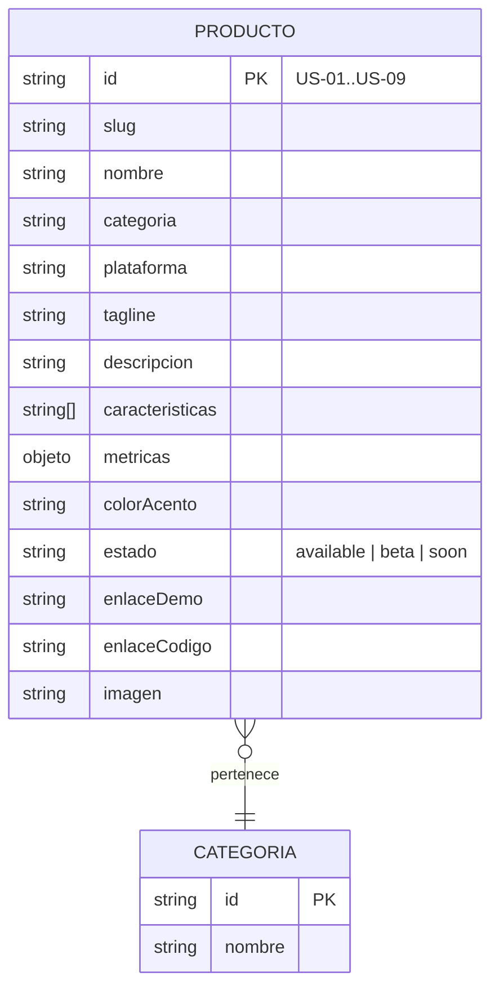

# Modelo de datos

No hay base de datos. El "modelo" es el catálogo estático en `assets/js/data.js` y el mensaje de contacto.

## Entidad: Producto

| Campo | Tipo | Regla |
|---|---|---|
| `id` | string | `US-NN`, único, inmutable. Es la firma visual. |
| `slug` | string | minúsculas y guiones; define la carpeta en `productos/`. |
| `estado` | enum | `available` (lima), `beta` (cobalto), `soon` (ámbar). Siempre con icono + texto. |

## Entidad: Contacto (lead)

| Campo | Tipo | Validación |
|---|---|---|
| `nombre` | string | requerido, 2–80 chars |
| `email` | string | requerido, formato email |
| `interes` | enum | producto que desea |
| `mensaje` | string | 10–1000 chars |
| `website` | string | honeypot, debe quedar vacío |

El formulario envía estos campos a Formspree; no se almacenan localmente.

## Diccionario de categories

`productividad` · `bienestar` · `finanzas` · `conocimiento` · `deporte` · `campo` · `privacidad`
