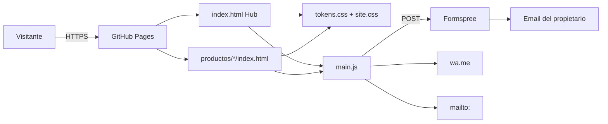

# Arquitectura — Brochure Uskein Studio

## ADR-001 — Sitio estático sin backend

- **Contexto:** brochure comercial multiproducto que debe publicarse gratis y sin coste recurrente.
- **Decisión:** HTML + CSS + JS vanilla, sin framework ni build step. Despliegue en GitHub Pages.
- **Alternativas:** Next.js/Vercel (build y lock-in), Netlify CMS (innecesario), WordPress (coste y mantenimiento).
- **Consecuencias:** coste 0, carga instantánea, cero superficie de ataque en servidor. El contenido se edita en archivos; no hay panel CMS.

## ADR-002 — Captación de leads sin servidor propio

- **Contexto:** se requiere formulario de contacto, WhatsApp y email sin backend.
- **Decisión:** formulario `POST` a Formspree (plan gratuito) con fallback `mailto:`; botones `wa.me` y `mailto:`.
- **Alternativas:** Netlify Forms (descartado al elegir GitHub Pages), Google Forms (peor experiencia de marca).
- **Consecuencias:** los leads llegan al correo del propietario. Formspree gratuito tiene límite mensual; el fallback garantiza que nunca se pierda un contacto.

## ADR-003 — Arquitectura de información Hub + hojas de producto

- **Contexto:** 9 productos con identidades visuales distintas requieren coherencia comercial.
- **Decisión:** `index.html` (hub) + una página por producto bajo `productos/<slug>/index.html`, compartiendo `assets/css/tokens.css` y `assets/js/main.js`.
- **Consecuencias:** URL limpias en GitHub Pages, navegación hacia atrás, y una sola fuente de verdad visual.

## Stack

| Capa | Tecnología | Justificación |
|---|---|---|
| Estructura | HTML5 semántico | Accesibilidad y SEO sin dependencias |
| Estilos | CSS custom properties | Los tokens del manual son directamente variables CSS |
| Interacción | JS vanilla (ES modules) | Sin build; menús, filtros, tema y formulario |
| Icons | Lucide (inline SVG, 18 px, trazo 1,5) | Un solo set, `currentColor` |
| Tipografía | Google Fonts (Archivo, Archivo Black, IBM Plex Mono) | Gratis, con fallback de sistema |
| Dominio | `<usuario>.github.io` | Gratis y estable |
| Formulario | Formspree + `mailto:` | Gratis, sin backend |

## Seguridad por diseño

- Sin secretos en el cliente: el endpoint de Formspree es público por diseño; se aplica honeypot y validación HTML5.
- Sin datos personales persistidos en el navegador más allá del tema (localStorage).
- HTTPS obligatorio en GitHub Pages.
- CSP compatible con Google Fonts y Formspree documentada en `GUIA_DEVOPS_SEGURIDAD.md`.

## Diagrama

