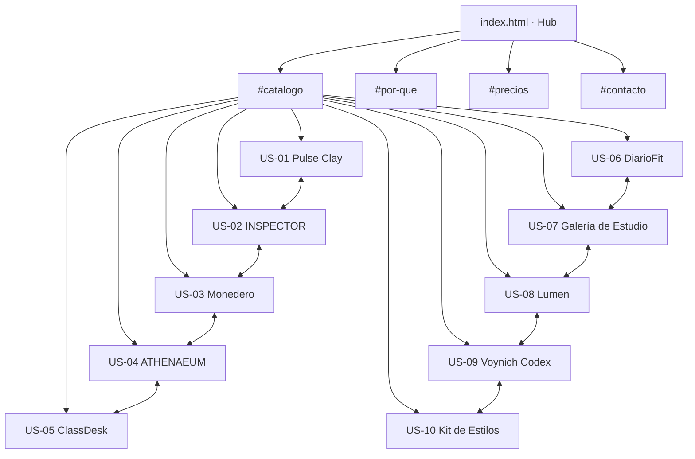

# Arquitectura de información

## Sitemap

## Reglas de navegación

| Elemento | Regla |
|---|---|
| Header | Sticky en todas las páginas; enlaces relativos `../../index.html#…` en fichas |
| Breadcrumb | `Inicio / Catálogo / US-NN`, solo en fichas |
| Filtros | Un nivel de profundidad; sin subcategorías |
| Product-nav | Circular: la última ficha enlaza a la primera y viceversa |
| Footer | Enlace al catálogo, cuatro productos destacados y contacto |
| CTA | Un CTA primario por pantalla; el secundario siempre es WhatsApp o correo |

## URL

- Hub: `/`
- Ficha: `/productos/<slug>/`
- Anclas del hub: `#catalogo`, `#por-que`, `#precios`, `#contacto`

> GitHub Pages sirve `productos/<slug>/index.html` como `/productos/<slug>/` sin configuración adicional.
