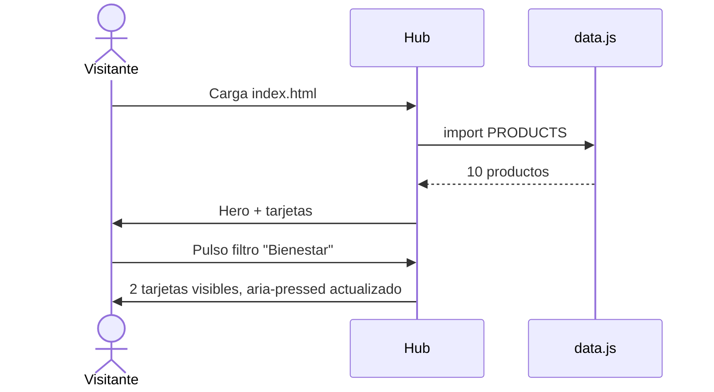
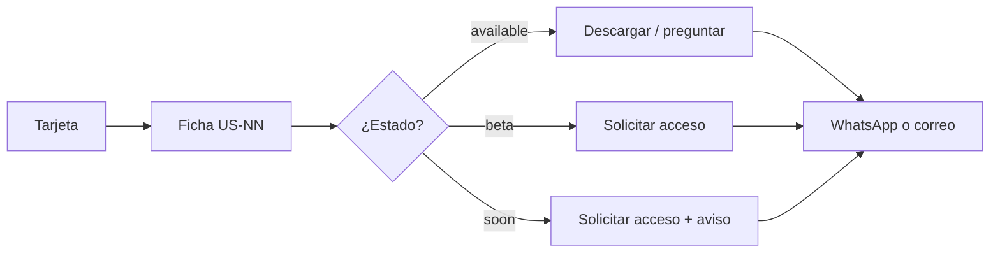
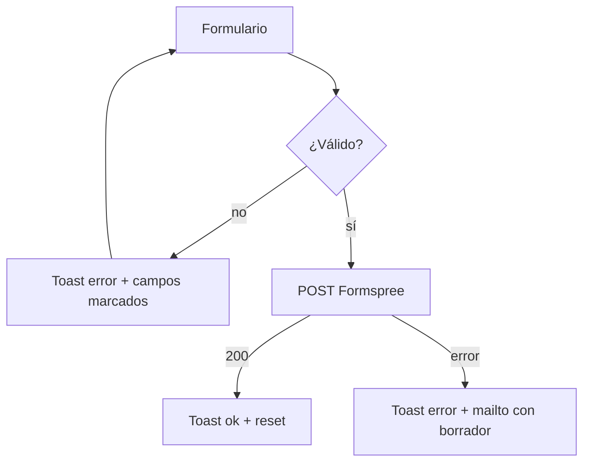

# Flujos de usuario

## F1 · Descubrimiento y filtrado (happy path)

## F2 · Evaluación de producto

## F3 · Contacto

## Flujos alternativos

| Situación | Comportamiento |
|---|---|
| Sin JavaScript | El contenido de las fichas no se renderiza; se muestra aviso. Mitigación: `noscript` añadido en el hub. |
| Formspree sin configurar | Se detecta `TU_FORM_ID` y se abre `mailto:` directamente. |
| Preferencia de movimiento reducido | Desactivar reveal, ping y transiciones. |
| Cambio de tema | Persistencia en `localStorage`; sin parpadeo porque se aplica antes del primer pintado. |
| Navegación circular | Última ficha → primera; primera → última. |
